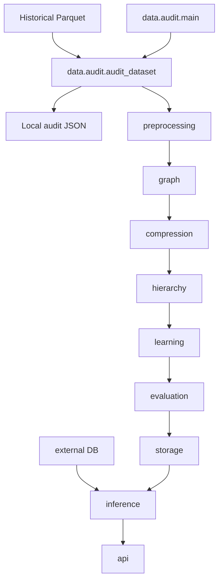
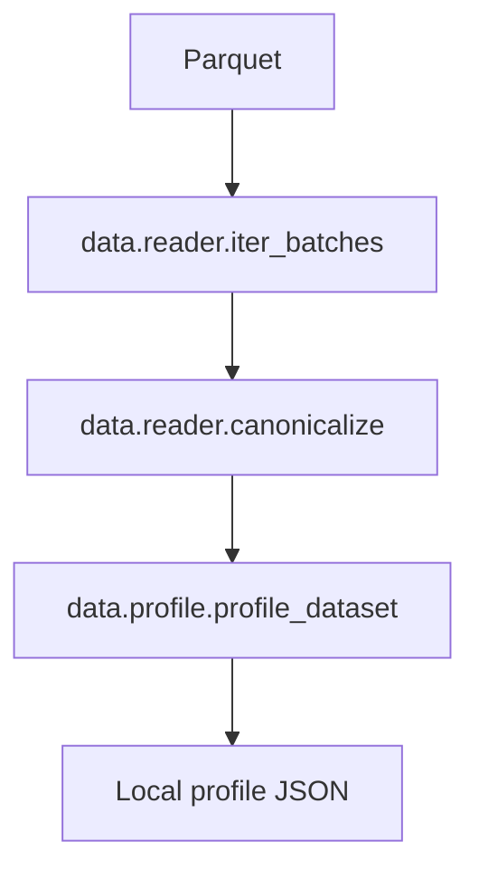
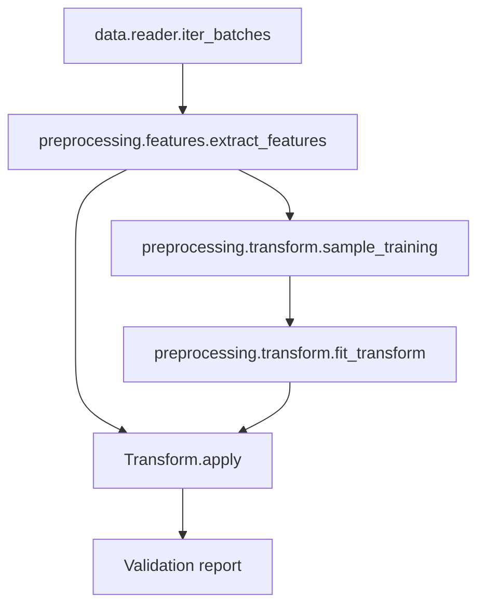
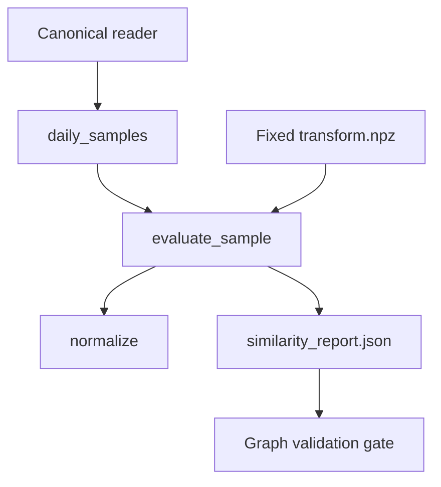

# Knowledge graph — planned architecture
Stage 1 audit code exists; execution and tests pending. The JSON graph is the canonical index; update both views at every stage. Paths are planned, not verified existing directories.

For every implemented function add its qualified name, repository path, inputs, outputs, calls, dependencies, stage, tests and status to graph.json. Add cross-module edges with explicit relation types. Do not infer call relationships without checking code. This view documents dependencies, not generated runtime images.

Stage 1 symbols: `data.audit.audit_dataset(root)` reads Parquet footers; `data.audit.main()` invokes it and writes local JSON. Tests: `tests/test_dataset_audit.py`. See [dataset instructions](../DATASET.md).

## Stage 1 canonical reader

Original flow timestamp retained; logical date follows folder. Tests and profile execution pending.

Stage 1 fix: `data.reader.canonicalize` calls `data.reader.safe_integer_cast`; invalid float-to-integer values become null and `iter_batches` forwards per-file counts to `data.profile.profile_dataset`. Regression test added; local retry pending.

## Stage 1 profile review
Profile received: 48,759,366 rows (29,411,750 normal; 19,347,616 attacks). 19,051 invalid dst_port casts, all normal, across 5,340 files; converted to null. No other checked invalid values; 7,319,029 missing label_binary; non-null labels and type match partitions. Missing country 16,840,679; behavioral_flags 41,473,304; threat_intel_score 13,887,652; each MITRE field 29,411,750. Profile execution confirmed, tests not confirmed. Proposed next: feature allowlist, exclude label-derived fields, unknown port handling without class-dependent deletion, source-overlap check and train-only preprocessing. Stage 1 review pending approval.

Stage 2 initial implementation: centralized 10000-row batch target; NumPy vectorized feature extraction, port categories, robust scaling and regularized ZCA; bounded uniform priority sample of 200000 rows from reconstructed clean reference only. Fit is provisional, not an independent temporal evaluation. Source overlap and final split pending. Reader retains per-file boundaries for provenance; preprocessing coalescing across files pending. Output transform NPZ and validation report only; no full transformed dataset persisted. Tests and local run pending.

Stage 2 execution report reviewed: all rows processed, batch target 10000, 200000 fit rows, 25 features. NPZ inspected: finite float64 arrays, positive scales, symmetric positive definite whitening, condition number approximately 871444. Four features have zero median and scaled mean with unit stored scale; variance requires verification. Stage 2 not scientifically accepted yet; feature distribution, covariance diagnostics, source overlap, final split and cross-file batching pending. Unit test results not supplied.

## Stage 2.1 similarity validation
Stage 2.1: user reports prior ordinary cosine similarities near 0.995 and improved discrimination after ZCA at threshold 0.85; historical observation, not measured by current code. Keep strict similarity > 0.85 as edge eligibility; do not artificially suppress genuine similarity or raise threshold to hide poor scaling. ZCA is a train-fitted continuous vector transform, not a similarity metric. Compare raw, robust, ZCA cosine and candidate mixed signed cosine (0.6) plus discrete exact match (0.4); upstream formula parity pending. Sample up to 10000 uniformly per logical day with deterministic seed, read in batches of 10000, compute all distinct within-sample pairs in 256-row blocks, exclude undefined zero-norm cosine pairs, report distributions, fractions above 0.85 and 0.995, threshold-only degree/isolation and same/cross partition rates (diagnostic only). No full graph, no threshold tuning or refit. Future union kNN k=12 and degree cap 20 remain candidate constraints. Daily sample degree is not full graph degree. Source overlap, final temporal split, cross-file coalescing, epsilon sensitivity and local tests remain pending. Output artifacts/preprocessing/similarity_report.json.

