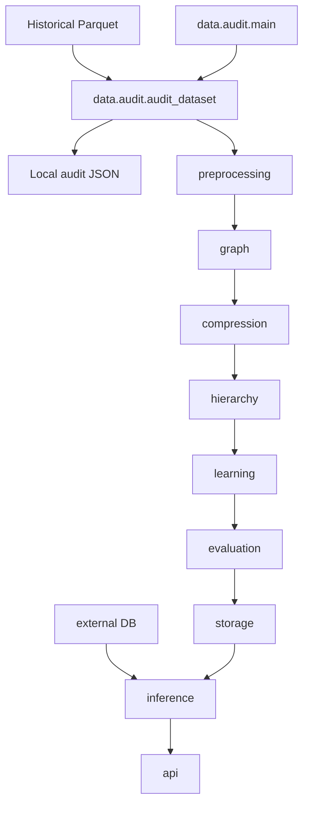
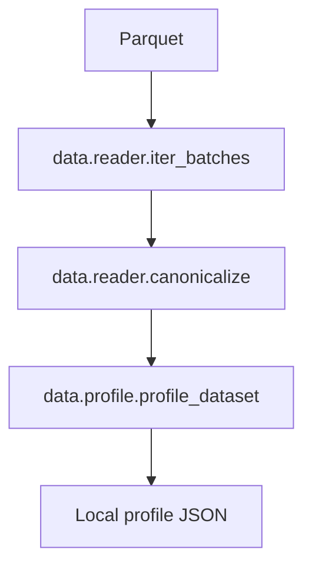
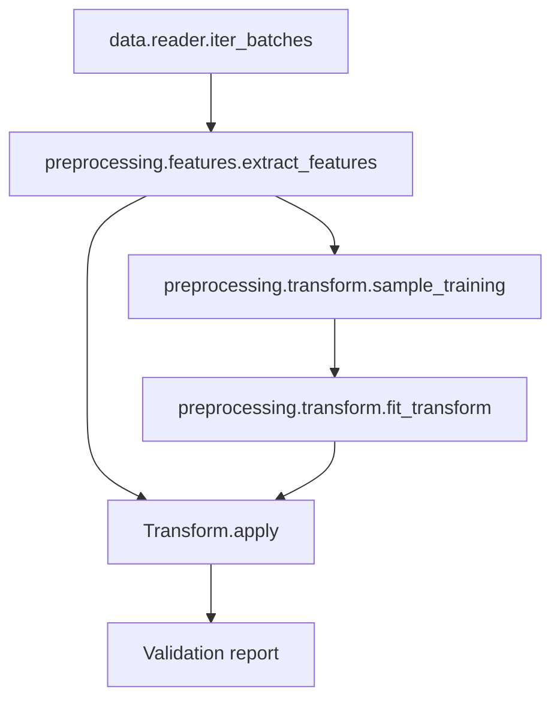
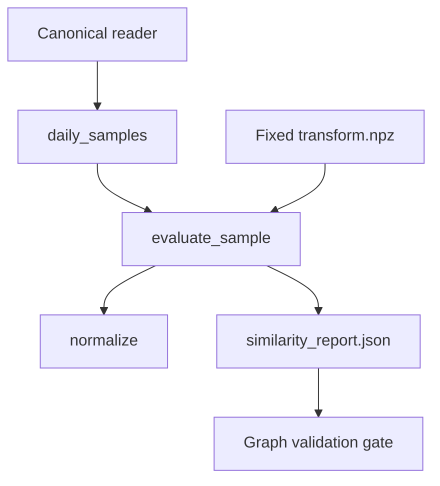
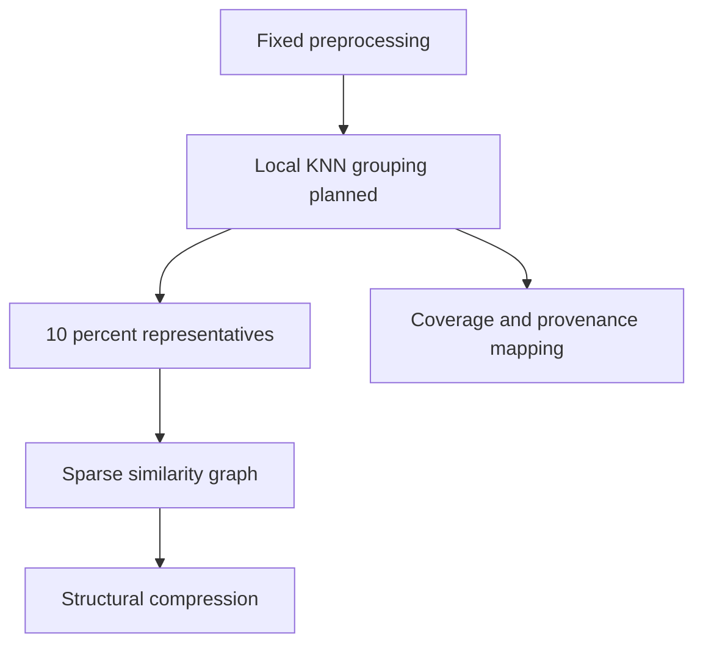
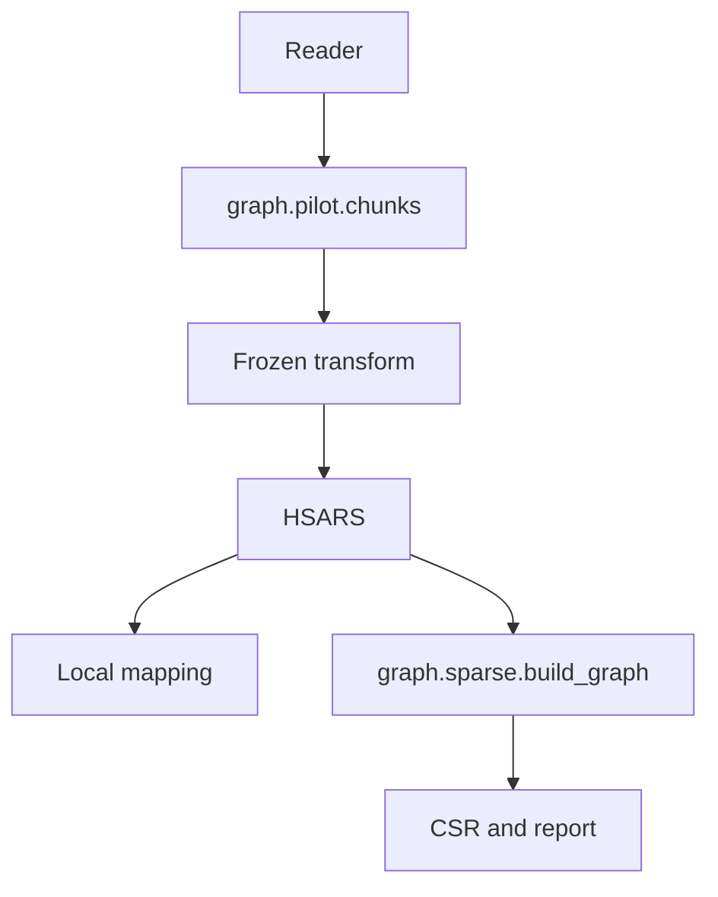
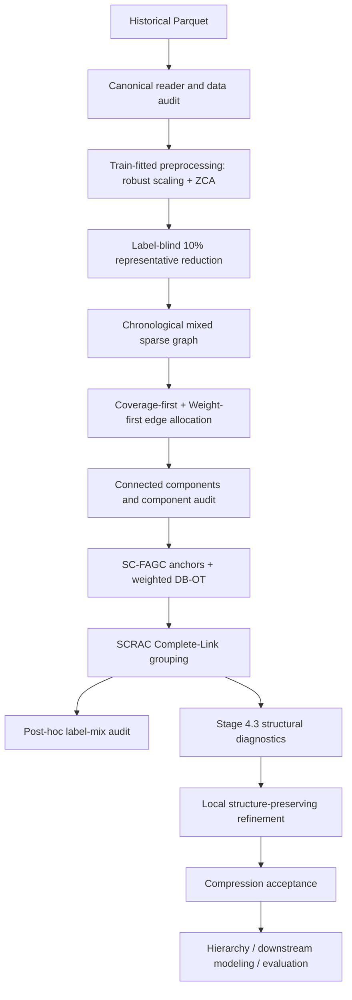

# Knowledge graph — planned architecture
Stage 1 audit code exists; execution and tests pending. The JSON graph is the canonical index; update both views at every stage. Paths are planned, not verified existing directories.

For every implemented function add its qualified name, repository path, inputs, outputs, calls, dependencies, stage, tests and status to graph.json. Add cross-module edges with explicit relation types. Do not infer call relationships without checking code. This view documents dependencies, not generated runtime images.

Stage 1 symbols: `data.audit.audit_dataset(root)` reads Parquet footers; `data.audit.main()` invokes it and writes local JSON. Tests: `tests/test_dataset_audit.py`. See [dataset instructions](../DATASET.md).

## Stage 1 canonical reader

Original flow timestamp retained; logical date follows folder. Tests and profile execution pending.

Stage 1 fix: `data.reader.canonicalize` calls `data.reader.safe_integer_cast`; invalid float-to-integer values become null and `iter_batches` forwards per-file counts to `data.profile.profile_dataset`. Regression test added; local retry pending.

## Stage 1 profile review
Profile received: 48,759,366 rows (29,411,750 normal; 19,347,616 attacks). 19,051 invalid dst_port casts, all normal, across 5,340 files; converted to null. No other checked invalid values; 7,319,029 missing label_binary; non-null labels and type match partitions. Missing country 16,840,679; behavioral_flags 41,473,304; threat_intel_score 13,887,652; each MITRE field 29,411,750. Profile execution confirmed, tests not confirmed. Proposed next: feature allowlist, exclude label-derived fields, unknown port handling without class-dependent deletion, source-overlap check and train-only preprocessing. Stage 1 review pending approval.

Stage 2 initial implementation: centralized 10000-row batch target; NumPy vectorized feature extraction, port categories, robust scaling and regularized ZCA; bounded uniform priority sample of 200000 rows from reconstructed clean reference only. Fit is provisional, not an independent temporal evaluation. Source overlap and final split pending. Reader retains per-file boundaries for provenance; preprocessing coalescing across files pending. Output transform NPZ and validation report only; no full transformed dataset persisted. Tests and local run pending.

Stage 2 execution report reviewed: all rows processed, batch target 10000, 200000 fit rows, 25 features. NPZ inspected: finite float64 arrays, positive scales, symmetric positive definite whitening, condition number approximately 871444. Four features have zero median and scaled mean with unit stored scale; variance requires verification. Stage 2 not scientifically accepted yet; feature distribution, covariance diagnostics, source overlap, final split and cross-file batching pending. Unit test results not supplied.

## Stage 2.1 similarity validation
Stage 2.1: user reports prior ordinary cosine similarities near 0.995 and improved discrimination after ZCA at threshold 0.85; historical observation, not measured by current code. Keep strict similarity > 0.85 as edge eligibility; do not artificially suppress genuine similarity or raise threshold to hide poor scaling. ZCA is a train-fitted continuous vector transform, not a similarity metric. Compare raw, robust, ZCA cosine and candidate mixed signed cosine (0.6) plus discrete exact match (0.4); upstream formula parity pending. Sample up to 10000 uniformly per logical day with deterministic seed, read in batches of 10000, compute all distinct within-sample pairs in 256-row blocks, exclude undefined zero-norm cosine pairs, report distributions, fractions above 0.85 and 0.995, threshold-only degree/isolation and same/cross partition rates (diagnostic only). No full graph, no threshold tuning or refit. Future union kNN k=12 and degree cap 20 remain candidate constraints. Daily sample degree is not full graph degree. Source overlap, final temporal split, cross-file coalescing, epsilon sensitivity and local tests remain pending. Output artifacts/preprocessing/similarity_report.json.

Stage 2.1 report reviewed: 26 daily samples, no undefined cosine pairs. Raw >0.85 rate 76.63%, robust 24.94%, ZCA 18.30%, candidate mixed 16.87% (daily means). Mixed reduces cross-partition threshold eligibility versus raw; not detection accuracy. Four continuous features are constant zero in clean-reference samples; retain pending missingness/source and active-subspace review. Keep threshold 0.85 and current transform provisionally; graph pilot must evaluate sparse kNN, degree caps, candidate recall and cross-batch neighbors. No final scientific acceptance, independent temporal validation, upstream mixed-formula parity or unit test confirmation yet.

## Pre-graph reduction architecture revision
Architecture revision requested by user: before initial similarity graph, process logical 10000-row chunks with fixed preprocessing and local unsupervised KNN-based grouping, retaining approximately 10% actual representative records (1000 per full chunk). This is distinct from later structure-aware graph compression. KNN grouping algorithm not yet specified or implemented; KNN alone is not clustering. Preserve rare/isolated behaviors via label-free novelty/coverage allocation, avoid density-only selection, retain source-to-representative mapping, multiplicity, distances and provenance; flag uncovered records rather than silently discarding them. Labels only for evaluation. Compare rare-pattern recall, coverage error, downstream PR-AUC/recall, cross-chunk neighbor recall, runtime/RAM against unreduced and random baselines. Fixed similarity threshold strictly >0.85; current ZCA provisional, mixed formula parity pending. Full chunk pair count 49,995,000 versus 499,500 for 1000 representatives; 99% reduction in graph-stage comparisons only, not end-to-end KNN cost. Use bounded block or indexed candidate search, no full dataset dense matrix. Cross-chunk representative edges must remain possible. Two successive 10% reductions would retain 1% overall; second-stage budget must be separately validated. Protect mapping and raw security data locally; do not publish raw records or identifiers. Pilot before acceptance; exact grouping, rarity budget, mapping format and cross-file coalescing pending.

## Stage 2.2 hybrid pilot
Stage 2.2 pilot HSARS: 256 random anchors, block matrix assignment in weighted normalized continuous + one-hot discrete embedding (candidate mixed similarity), inverse sqrt group-size weighted coverage sampling, low anchor similarity rarity selection, then low selected-set similarity diversity fill. 10% ceiling budget; anchors included before allocating remaining budget 60% coverage, 15% rarity, remainder diversity. Zero-norm rows flagged uncovered. Final mapping and multiplicity retained in memory; pilot report only. Compare identical daily 10000 samples against random, report coverage >0.85, p05, mean, partition coverage, selection time. No raw KNN, no full pair matrix; exact upstream parity, production coalescing, rare subtype recall, cross-chunk and downstream evaluation pending. Parameters provisional; local tests not run.

Stage 2.2 pilot report reviewed: 26 daily samples of 10000, 26000 representatives, hybrid coverage 100% versus random 99.545% (1183 uncovered random rows); mean similarity .989006 vs .986190, mean daily p05 .946145 vs .929323; mean selection+assignment time .064702 vs .038395 seconds, 1.685x. Hybrid attack and normal assignment coverage 100% on samples, not detection recall. Hybrid selected 4907 attack representatives vs random 8363; multiplicity and subtype coverage require evaluation. Keep 256 anchors, 10% budget, strict >.85 provisionally. Next gate: production chronological coalesced chunks, stable provenance, cross-chunk sparse graph pilot, rare subtype and non-self coverage, memory and end-to-end timing; source overlap and mixed formula parity pending. No unit-test confirmation. No code change.

## Stage 3 exact graph pilot
Stage 3 approved and bounded exact graph pilot implemented. graph.pilot.chunks coalesces file-order rows within selected logical day, retaining relative source path and zero-based file row offset. Not chronological within day or class-balanced. Frozen transform then HSARS 10%, persist mapping and multiplicity locally. graph.sparse.build_graph computes signed mixed similarity 0.6 cosine + 0.4 discrete match across all pilot representatives including cross-chunk, excludes zero-norm and self pairs, union top12, strict >0.85, deterministic descending-weight greedy symmetric degree cap20, CSR including isolates. Default 5 chunks, max20, block128; exact quadratic pilot not full-day scalable ANN. Report coverage, degree, edges, cross-chunk edges, isolates, CSR bytes, prepare and graph time; peak RAM, candidate recall, chronological merge and downstream validation pending. SciPy dependency added. Local tests not executed. Run python -m graph.pilot; artifacts/graph/pilot/report.json only to share. Mapping and nodes sensitive, keep local. Use fresh output directory for each run.

## Stage 3 pilot review
Stage 3 pilot report reviewed: 50000 rows, 5 chunks, 5000 nodes, coverage 1.0, 53709 union candidates, 11606 retained edges, 4178 cross-chunk edges, 3422 isolates (68.44%), max degree 20, mean degree 4.6424, minimum edge similarity .8546473911, preparation 4.68353s, graph 4.08858s, CSR 298548 bytes. Structural acceptance blocked: distinguish threshold isolates, top-k candidate isolates and degree-cap-induced isolates; greedy strongest-first saturation is a hypothesis, not confirmed. Proposed coverage-first degree-constrained edge allocation then weight-prioritized fill, compare against current baseline with unchanged strict threshold and cap; preserve genuine isolates. No code changes or unit test confirmation. Full-day ANN, peak RAM, chronological ordering, independent temporal validation pending.

## Stage 3.1 isolation diagnosis
User target approximately 10% isolates, not a forced connectivity constraint. Added graph/isolation_validation.py: scan saved pilot nodes once in blocks, exact best non-self mixed similarity and union top12 candidates above .775; evaluate strict thresholds .85,.825,.8,.775 with cap20, compare strongest-first and coverage-first (match two isolates, attach remaining isolates, fill strongest). Distinguish undefined cosine, no threshold neighbor, candidate isolates, cap-induced isolates; report edge weights, cross-chunk edges and timings. No production threshold change; local run and tests pending. Output artifacts/graph/pilot/isolation_report.json.

## Stage 3 pilot acceptance
Stage 3 isolation report reviewed and user accepts approximately 20% isolates. At all tested thresholds .85,.825,.8,.775, all 5000 nodes have eligible neighbors; Weight-First yields 3422 isolates (68.44%), Coverage-First followed by Weight-First yields 1046 (20.92%). At .85 hybrid retains 12503 edges, 6123 cross-chunk edges, mean similarity .998012824, cap20. Keep strict .85, k12, cap20, HSARS .1. Record Weight-First as baseline and final fill phase; hybrid is recommended continuation based on accepted result, not yet integrated into graph.pilot/build_graph. Pilot acceptance only; integration, regression tests, label composition, chronological mixed chunks, scalable candidate search, peak RAM and independent evaluation remain pending. No production code changed.

## Stage 3 integration
Stage3 integration: build_graph defaults coverage-first then weight-first via isolation_validation.allocate; weight_first baseline remains selectable. finalize shares CSR allocation; build_indexed_graph uses scipy cKDTree on mixed embedding, pool64 eps.2, exact mixed rerank, approximate candidate recall and speed unverified. graph.pilot.chunks now reads selected logical day, canonicalizes batches, sorts feature arrays by timestamp (one-day RAM, not fully streaming), preserves file/offset provenance. label_summary uses partition labels after selection, reports representative and mapped-member isolation rates. CLI --backend exact/indexed, --full-day requires indexed. Tests added, not executed locally. Pilot exact then indexed on same chronological sample before full-day; full-day memory, runtime, candidate recall and isolation rate not established. Stage4 not started.

## Stage 3 chronological backend comparison
Chronological 50k pilot reviewed: exact/indexed 5000 nodes, 39929 union candidates each, 34253/34254 edges, 24800 cross-chunk edges each, zero isolates, coverage 1, cap20, min similarity .8505345873. Graph seconds 4.975752/1.018060 (4.89x); total 6.704639/2.670917 (2.51x). Both reports contain zero attack members and representatives by partition label; no mixed-class validation. Indexed provisionally preferred, edge-set recall not established by counts. Full-day run and memory validation pending; no code changes.

## Stage 4 component audit
Stage 3 operational acceptance on two full-day runs; scientific ANN recall, peak RAM and independent validation pending. Stage 4 implemented graph/components.py: validate CSR symmetry, weights, degree and no loops; scipy connected_components including singletons; mapping_stats verifies multiplicity and partition labels with portable separators; analyze computes component size, raw mass, edges, density, edge mean and exact valid representative all-pair mixed mean via grouped sums/counts, coverage and posthoc label composition. No dense pair matrix, no graph modification. CLI reads existing graph artifacts and writes components.npz and aggregate report.json. Tests added, local execution pending. Stage 5 blocked until component review.

Zero-mass anchor columns are removed before DB-OT; row normalization and total mass are checked; effective cluster count is capped by active anchors. Regression execution pending.

Stage 4.1 correction: max-nearest-similarity farthest-first, redundant anchor stop, self-owned anchor rows, uniform tied weights, sparse B, log-domain weighted OT with weighted entropy and feasibility gate, group-count penalty and group opening score 0.75. Default intermediate clusters capped at 32. Real-data and regression tests pending; hybrid centrality selection and independent complete-link audit pending.

## Adaptive anchor expansion (2026-11-25)

The initial 5% anchor budget is a starting seed, not a cap. Each component is compared against current anchors using the configured mixed-similarity threshold (default 0.85). If at least one existing anchor has similarity strictly greater than the threshold, the component is assigned to its nearest qualifying anchors (up to anchor-k). Otherwise the component becomes a new anchor and can represent later components. The bipartite matrix is sparse; each row sums to one and anchor rows self-assign. Reports distinguish initial coverage, components requiring new anchors, number of newly created anchors, final anchor count, and each creation reason. Threshold is an experimental hyperparameter and must be evaluated separately from SCRAC Complete-Link.

## Post-hoc class-mixture audit (2026-11-25)

- `scripts/audit_scrac_label_mix.py` is an evaluation-only consumer; it is not imported by graph construction, representative selection, SC-FAGC, or SCRAC.
- Inputs: pilot `mapping_*.npz` files (raw row -> graph node and source partition), `components.npz` (graph node -> initial component and raw_rows/attack_rows), and final SCRAC JSON assignment (initial component -> final group).
- Counts attack/normal raw rows for each final group; reports class percentages, mixed/pure groups, macro impurity and raw-row-weighted impurity.
- Validates mapping-derived raw-row totals against components.raw_rows and reconstructed attack totals against components.attack_rows. Mismatch fails closed.
- An attack-only source day is explicitly flagged; apparent all-attack purity must not be interpreted as clustering performance.
- Labels are never used in model fitting or assignment. Original mapping artifacts are required; nodes.npz and components.npz alone do not preserve per-raw-row source partition.
- Run: `python -m scripts.audit_scrac_label_mix --mapping-dir artifacts/graph/pilot --components artifacts/graph/components/components.npz --assignment-report artifacts/graph/sc_fagc/report_cubic200.json --output artifacts/graph/sc_fagc/label_mix_cubic200.json`.
- Validation status: synthetic tests added; local execution on the user's real pilot artifacts is pending.

## End-to-end project status (2026-11-25)

### Current position: Stage 4.2 completed; Stage 4.3 next

Completed and reviewed on the 50k pilot (2026-11-25): 5000 graph representative nodes representing 50000 raw rows from logical day 2026-06-21. Node-level SCRAC avoids treating a giant connected component as indivisible. SC-FAGC ran once for the six-configuration sweep and converged in 216 iterations. Total sweep runtime was 898.614 seconds including the shared SC-FAGC pass; individual SCRAC runs took approximately 121.8-123.1 seconds. Final groups: 388-390; singletons: 13-14; largest group: 174-200 representative nodes; zero capacity violations. All 5000 nodes assigned and 50000 raw rows conserved. Clustering reads mapping node indices only for represented mass and does not read source partition labels. Separate post-hoc audit found 17735 attack and 32265 normal raw rows.

### SCRAC sensitivity results

| Acceptance | Cubic lambda | Groups | Mixed groups | Macro impurity | Raw-row weighted impurity |
|---:|---:|---:|---:|---:|---:|
| 0.75 | 0.20 | 388 | 23 | 0.8055% | 1.996% |
| 0.75 | 0.30 | 390 | 25 | 0.8680% | 1.968% |
| 0.78 | 0.20 | 389 | 23 | 0.8020% | 1.954% |
| 0.78 | 0.30 | 390 | 25 | 0.8211% | 2.000% |
| 0.80 | 0.20 | 389 | 23 | 0.8019% | 1.954% |
| 0.80 | 0.30 | 390 | 24 | 0.8190% | 2.000% |

Mixed groups are accepted as a natural possible outcome of unsupervised mathematical compression; zero mixed groups is explicitly not an objective. Labels must not be used to select anchors, construct similarities, assign or refine groups. The 0.78/0.20 setting is only a modest candidate; 0.78/0.20 and 0.80/0.20 are effectively tied. Lambda 0.30 is not supported. Do not change production defaults yet.

### Stage 4.3 — next active phase: structural diagnostics

Planned, not implemented. Measure within-group similarity distributions (minimum, p05, median, mean, p95), independently verify Complete-Link, measure feature-wise similarity contributions, cohesion/dispersion, medoid/centrality, boundary members, and pre/post graph structural preservation. Test order sensitivity with multiple deterministic permutations and label-free partition agreement. Only after diagnostics, design bounded local refinement that preserves capacity and Complete-Link while improving a graph-structure objective. Keep baseline outputs immutable and report runtime/memory.

Acceptance gates: all 5000 nodes assigned; raw-row mass conserved; capacity <=200; every within-group pair strictly >0.85; no label input; graph structure preservation measured; runtime and memory reported. Full-day run and independent day replication remain pending.
