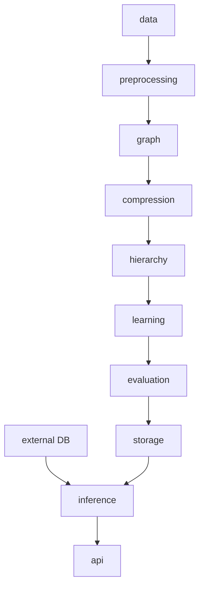

# Knowledge graph — planned architecture
No implementation symbols exist yet. The JSON graph is the canonical index; update both views at every stage. Paths are planned, not verified existing directories.

For every implemented function add its qualified name, repository path, inputs, outputs, calls, dependencies, stage, tests and status to graph.json. Add cross-module edges with explicit relation types. Do not infer call relationships without checking code. This view documents dependencies, not generated runtime images.
