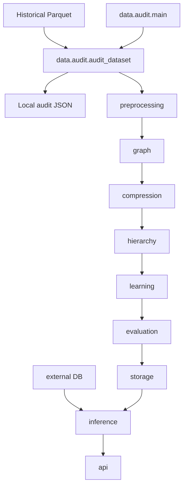
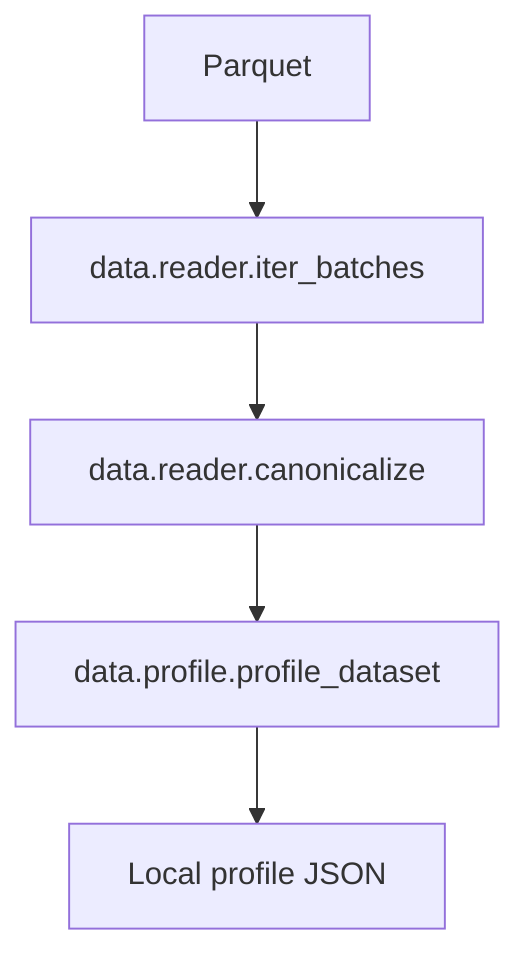
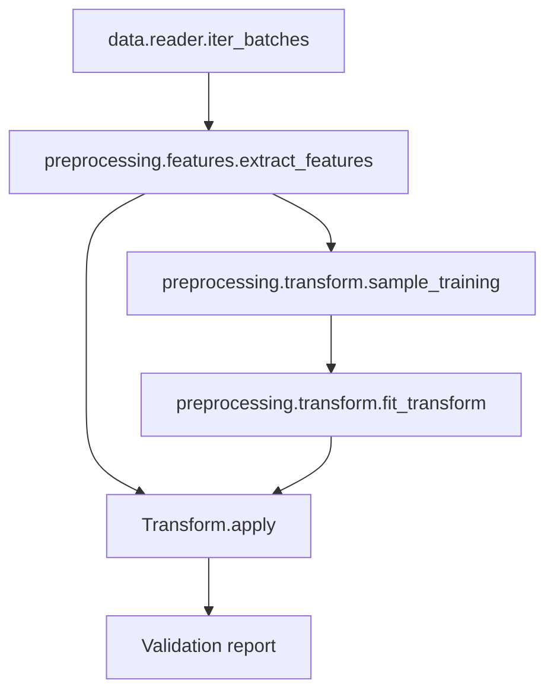
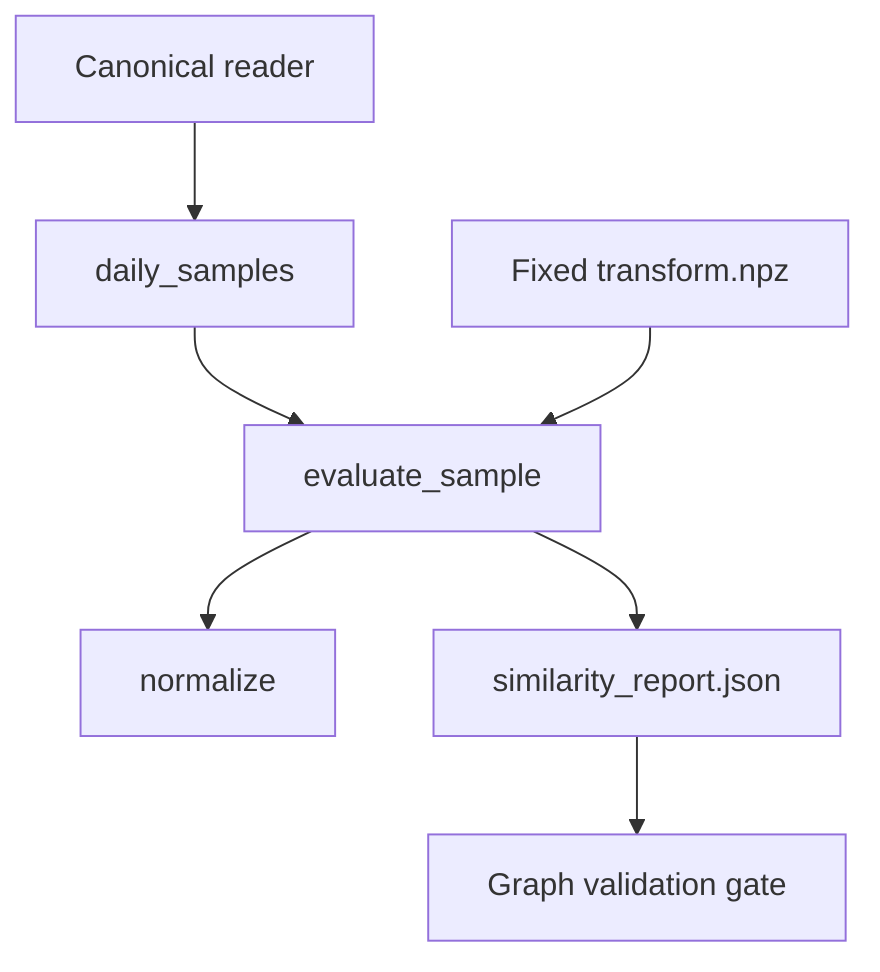
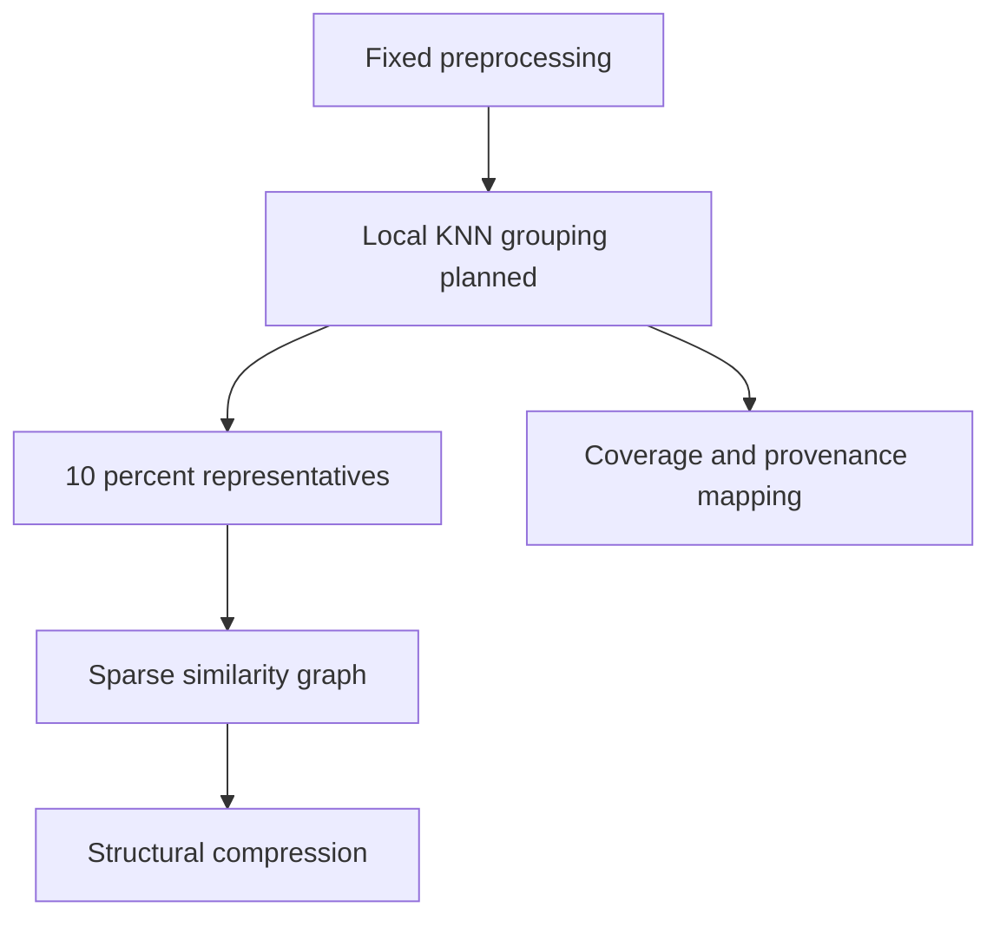

# Knowledge graph — planned architecture
Stage 1 audit code exists; execution and tests pending. The JSON graph is the canonical index; update both views at every stage. Paths are planned, not verified existing directories.

For every implemented function add its qualified name, repository path, inputs, outputs, calls, dependencies, stage, tests and status to graph.json. Add cross-module edges with explicit relation types. Do not infer call relationships without checking code. This view documents dependencies, not generated runtime images.

Stage 1 symbols: `data.audit.audit_dataset(root)` reads Parquet footers; `data.audit.main()` invokes it and writes local JSON. Tests: `tests/test_dataset_audit.py`. See [dataset instructions](../DATASET.md).

## Stage 1 canonical reader

Original flow timestamp retained; logical date follows folder. Tests and profile execution pending.

Stage 1 fix: `data.reader.canonicalize` calls `data.reader.safe_integer_cast`; invalid float-to-integer values become null and `iter_batches` forwards per-file counts to `data.profile.profile_dataset`. Regression test added; local retry pending.

## Stage 1 profile review
Profile received: 48,759,366 rows (29,411,750 normal; 19,347,616 attacks). 19,051 invalid dst_port casts, all normal, across 5,340 files; converted to null. No other checked invalid values; 7,319,029 missing label_binary; non-null labels and type match partitions. Missing country 16,840,679; behavioral_flags 41,473,304; threat_intel_score 13,887,652; each MITRE field 29,411,750. Profile execution confirmed, tests not confirmed. Proposed next: feature allowlist, exclude label-derived fields, unknown port handling without class-dependent deletion, source-overlap check and train-only preprocessing. Stage 1 review pending approval.

Stage 2 initial implementation: centralized 10000-row batch target; NumPy vectorized feature extraction, port categories, robust scaling and regularized ZCA; bounded uniform priority sample of 200000 rows from reconstructed clean reference only. Fit is provisional, not an independent temporal evaluation. Source overlap and final split pending. Reader retains per-file boundaries for provenance; preprocessing coalescing across files pending. Output transform NPZ and validation report only; no full transformed dataset persisted. Tests and local run pending.

Stage 2 execution report reviewed: all rows processed, batch target 10000, 200000 fit rows, 25 features. NPZ inspected: finite float64 arrays, positive scales, symmetric positive definite whitening, condition number approximately 871444. Four features have zero median and scaled mean with unit stored scale; variance requires verification. Stage 2 not scientifically accepted yet; feature distribution, covariance diagnostics, source overlap, final split and cross-file batching pending. Unit test results not supplied.

## Stage 2.1 similarity validation
Stage 2.1: user reports prior ordinary cosine similarities near 0.995 and improved discrimination after ZCA at threshold 0.85; historical observation, not measured by current code. Keep strict similarity > 0.85 as edge eligibility; do not artificially suppress genuine similarity or raise threshold to hide poor scaling. ZCA is a train-fitted continuous vector transform, not a similarity metric. Compare raw, robust, ZCA cosine and candidate mixed signed cosine (0.6) plus discrete exact match (0.4); upstream formula parity pending. Sample up to 10000 uniformly per logical day with deterministic seed, read in batches of 10000, compute all distinct within-sample pairs in 256-row blocks, exclude undefined zero-norm cosine pairs, report distributions, fractions above 0.85 and 0.995, threshold-only degree/isolation and same/cross partition rates (diagnostic only). No full graph, no threshold tuning or refit. Future union kNN k=12 and degree cap 20 remain candidate constraints. Daily sample degree is not full graph degree. Source overlap, final temporal split, cross-file coalescing, epsilon sensitivity and local tests remain pending. Output artifacts/preprocessing/similarity_report.json.

Stage 2.1 report reviewed: 26 daily samples, no undefined cosine pairs. Raw >0.85 rate 76.63%, robust 24.94%, ZCA 18.30%, candidate mixed 16.87% (daily means). Mixed reduces cross-partition threshold eligibility versus raw; not detection accuracy. Four continuous features are constant zero in clean-reference samples; retain pending missingness/source and active-subspace review. Keep threshold 0.85 and current transform provisionally; graph pilot must evaluate sparse kNN, degree caps, candidate recall and cross-batch neighbors. No final scientific acceptance, independent temporal validation, upstream mixed-formula parity or unit test confirmation yet.

## Pre-graph reduction architecture revision
Architecture revision requested by user: before initial similarity graph, process logical 10000-row chunks with fixed preprocessing and local unsupervised KNN-based grouping, retaining approximately 10% actual representative records (1000 per full chunk). This is distinct from later structure-aware graph compression. KNN grouping algorithm not yet specified or implemented; KNN alone is not clustering. Preserve rare/isolated behaviors via label-free novelty/coverage allocation, avoid density-only selection, retain source-to-representative mapping, multiplicity, distances and provenance; flag uncovered records rather than silently discarding them. Labels only for evaluation. Compare rare-pattern recall, coverage error, downstream PR-AUC/recall, cross-chunk neighbor recall, runtime/RAM against unreduced and random baselines. Fixed similarity threshold strictly >0.85; current ZCA provisional, mixed formula parity pending. Full chunk pair count 49,995,000 versus 499,500 for 1000 representatives; 99% reduction in graph-stage comparisons only, not end-to-end KNN cost. Use bounded block or indexed candidate search, no full dataset dense matrix. Cross-chunk representative edges must remain possible. Two successive 10% reductions would retain 1% overall; second-stage budget must be separately validated. Protect mapping and raw security data locally; do not publish raw records or identifiers. Pilot before acceptance; exact grouping, rarity budget, mapping format and cross-file coalescing pending.

## Stage 2.2 hybrid pilot
Stage 2.2 pilot HSARS: 256 random anchors, block matrix assignment in weighted normalized continuous + one-hot discrete embedding (candidate mixed similarity), inverse sqrt group-size weighted coverage sampling, low anchor similarity rarity selection, then low selected-set similarity diversity fill. 10% ceiling budget; anchors included before allocating remaining budget 60% coverage, 15% rarity, remainder diversity. Zero-norm rows flagged uncovered. Final mapping and multiplicity retained in memory; pilot report only. Compare identical daily 10000 samples against random, report coverage >0.85, p05, mean, partition coverage, selection time. No raw KNN, no full pair matrix; exact upstream parity, production coalescing, rare subtype recall, cross-chunk and downstream evaluation pending. Parameters provisional; local tests not run.
